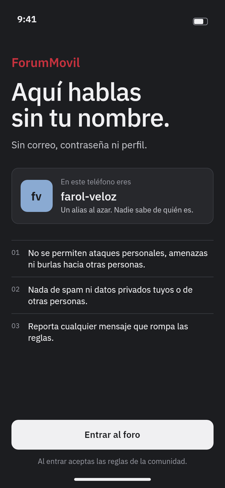
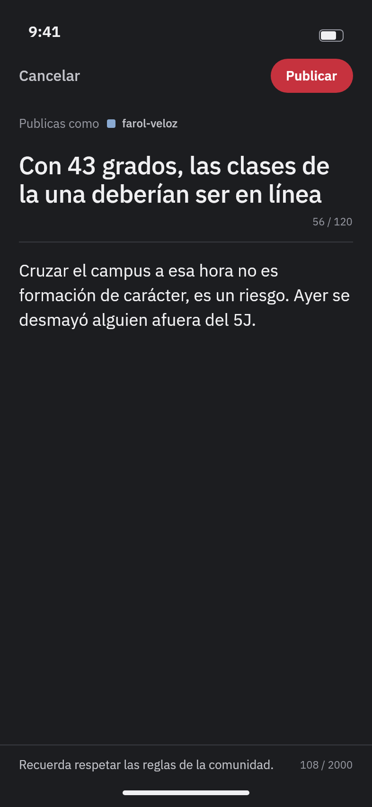
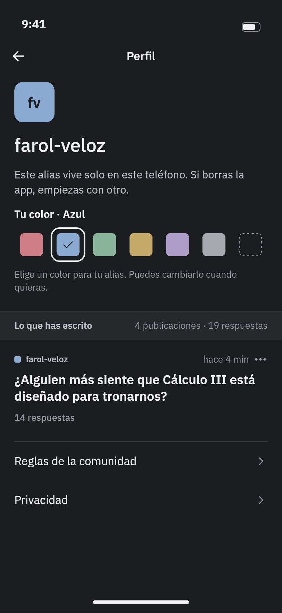

# ForumMovil

Foro móvil anónimo desarrollado para la materia de Desarrollo de Aplicaciones Móviles. Permite compartir ideas, preguntas y opiniones sin correo ni contraseña: al entrar, la aplicación asigna un alias aleatorio y un sello de color personalizable para publicar, responder, editar con historial de versiones y reportar contenido.

Construido con Expo SDK 58, React Native y TypeScript en el cliente (`app/`), y Supabase (sesiones anónimas, PostgreSQL, Row Level Security y Edge Functions para moderación) en el backend (`supabase/`).

## Capturas de pantalla

<table>
  <tr>
    <td align="center">
      
      <br />
      <sub>Bienvenida</sub>
    </td>
    <td align="center">
      
      <br />
      <sub>Foro</sub>
    </td>
    <td align="center">
      
      <br />
      <sub>Hilo y respuestas</sub>
    </td>
  </tr>
  <tr>
    <td align="center">
      
      <br />
      <sub>Escribir publicación</sub>
    </td>
    <td align="center">
      
      <br />
      <sub>Perfil</sub>
    </td>
    <td></td>
  </tr>
</table>

## Cómo compilar y abrir

### Requisitos

* Node.js 22 o superior
* Una cuenta y proyecto en [Supabase](https://supabase.com)
* Expo Go (SDK 58) en Android o iOS para pruebas rápidas, o Android Studio / Xcode para compilar de forma nativa

### 1. Configurar el backend en Supabase

1. Crea un proyecto nuevo en [supabase.com](https://supabase.com).
2. En el panel de Supabase, ve a **Authentication > Sign In / Providers** y activa el inicio de sesión anónimo.
3. Abre el **SQL Editor** y ejecuta en orden cada archivo dentro de `supabase/migrations/`.
4. En **Project Settings > API Keys**, copia la URL del proyecto y la llave publicable.

### 2. Configurar variables de entorno

Dentro de la carpeta `app/`, crea tu archivo `.env` a partir del ejemplo:

```bash
cd app
cp .env.example .env
```

Completa `.env` con los valores de tu proyecto de Supabase (`EXPO_PUBLIC_SUPABASE_URL` y `EXPO_PUBLIC_SUPABASE_PUBLISHABLE_KEY`). Nunca incluyas la llave secreta en este archivo.

### 3. Instalar dependencias y abrir la app

```bash
cd app
npm install
npx expo start
```

Escanea el código QR con **Expo Go** en tu teléfono o abre un emulador desde la terminal de Expo.

### 4. Compilar de forma nativa

Si prefieres generar y abrir una compilación nativa local (requiere Android SDK o Xcode):

```bash
cd app
npx expo run:android
```

En macOS para iOS:

```bash
cd app
npx expo run:ios
```

### 5. Verificación local

Dentro de `app/`:

```bash
npm run lint
npm run tsc
npm test
```

## Releases

Las versiones empaquetadas del proyecto están disponibles en la sección de [Releases](https://github.com/LuisEncinasAlegre/ForumMovil/releases) del repositorio.

## Integrantes

Universidad de Sonora  
Ingeniería en Sistemas de Información  
Desarrollo de Aplicaciones Móviles

* Luis Fernando Encinas Alegre
* José Diego Salgueiro Duarte
* Benjamin Isaac Rivera Tapia
* Sergio Alejandro Olivas Salazar
* Alex Gabi José José
